# CLMoE-VQE 연구 개요: Expert 확장·동결 기반 멀티모달 Continual Learning

기준일: 2026-10-21 · 브랜치: `research/multimodal-cl` · 상태: **확인 실험(G1–G5) 완료, Flickr 실패 원인 진단 및 P0 재검증 준비 중**

이 문서는 연구 목표, 차별성, 실험 결과, 시각화·분석, 전체 계획과 진행 상황, 참고 문헌을 한 곳에 정리한 진입점이다. 세부 수치와 해석 근거는 [멀티모달 연구 정리](MULTIMODAL_RESEARCH_SUMMARY.md), [설계](MULTIMODAL_DESIGN.md), [실험 기록](MULTIMODAL_EXPERIMENTS.md), [논문화 실행 계획](멀티모달%20CL%20논문화%20실행%20계획.md)에 있다. 모든 그림은 커밋된 artifact에서 [`scripts/make_research_figures.py`](scripts/make_research_figures.py)로 다시 생성한다.

> **요약**
> 1. 고정 BLIP 위의 task별 LoRA expert 확장·동결은 shared·capacity-matched adapter보다 **최종 성능이 높고 망각이 작다**. 8 seed, Holm 보정 후 4개 비교 모두 유의하다.
> 2. 그러나 **task당 64장 replay는 이기지 못했다.** Caption은 유의하게 열세이고, VQA는 평균이 낮지만 유의하지 않다.
> 3. 가장 큰 실패는 **Flickr30k**다. 후속 task로 학습한 Flickr 16조건 모두 학습 후 점수가 오히려 떨어졌다.
> 4. 10월 16–21일 진단에서 Flickr 실패의 주원인으로 **캡션 타깃 끝의 마침표와 종료(EOS) 실패**를 찾았다. 학습 타깃에서 마침표 하나만 제거하자 Flickr validation CIDEr-D가 3 seed 평균 0.108에서 0.280으로 올랐고 EOS 도달률은 1.00이 됐다.
> 5. 이 발견은 G4의 caption 결론, Flickr normalizer, routing 진단에 모두 영향을 줄 수 있다. 다음 단계는 사전 등록한 P0 재검증이다.

---

## 1. 연구 목표

### 1.1 상위 질문

**MoE식 expert 확장·동결이 continual learning(CL)에서 실제로 의미가 있는가?**

새 task가 오면 작은 expert(LoRA)를 추가하고 이전 expert를 동결하면 망각이 줄어든다는 아이디어는 SEMA, CL-MoE, SMoLoRA 등 여러 연구가 공유한다. 이 연구는 새 구조를 제안하기 전에 다음을 확인하려 했다.

- 망각 감소가 **최종 성능 우위**로 이어지는가?
- 같은 용량의 단일 adapter와 단순 replay 같은 **강한 baseline**보다도 나은가?
- 그 효과가 VQA 하나가 아니라 **서로 다른 생성 task family(VQA + captioning)**에서도 유지되는가?

### 1.2 단계별 연구 질문

| 단계 | 질문 | 결론 | 문서 |
|---|---|---|---|
| A. LLM-side SEMA 이식 | SEMA 확장을 LLaVA(Vicuna-7B) MLP에 이식하면 VQA CL이 개선되는가? | **미지지.** 자동 확장이 발생하지 않았고 AP는 sequential보다 낮았다(16 runs). | [RESULTS.md](RESULTS.md), [LEGACY_LLM.md](LEGACY_LLM.md) |
| B. Vision-side SEMA | 원본 위치(ViT)에 맞춘 SEMA가 VQA에서 확장 고유의 이득을 내는가? | **미입증.** 학습량을 맞춘 no-expansion보다 우월하지 않았다(74 runs). | [README.md](README.md#최종-결과-vision-side-실험74개) |
| C. VQA readout expansion | BLIP 질문 encoder·답변 decoder에 task별 LoRA expert를 두면 VQA CL이 개선되는가? | **부분 지지.** Shared·capacity 대비 AP +6.5~+10.3pp였으나 CL4VQA에서는 tuned replay에 졌다(128 runs + 160 routing 조건). | [VQA_CLOSURE.md](VQA_CLOSURE.md) |
| **D. 멀티모달 CL (현재)** | 같은 구조가 VQA + captioning이 섞인 heterogeneous stream에서도 유지되는가? | **보존은 성공, replay 대비 우위는 실패.** 원인 진단이 진행 중이다. | 이 문서 |

### 1.3 이번 단계의 가설 (사전 선언)

| 가설 | 내용 | 결과 |
|---|---|---|
| H1. 보존·최종 성능 | Expansion이 shared, capacity-matched, replay보다 최종 성능이 높다. | shared·capacity 대비 지지, **replay 대비 기각** |
| H2. 신규 학습 | 낮은 망각이 새 task를 배우지 않은 결과가 아니다. | VQA·COCO 지지, **Flickr 실패** |
| H3. Positive transfer | CL 학습 직후 점수가 같은 seed의 독립 학습보다 높다. | VQA −0.043, caption +0.020. **일반적 전이 없음** |
| H4. Routing | 성능이 단순 family 구분이 아니라 task 단위 routing에 의존한다. | 오routing은 거의 family 내부에서만 발생. Task-ID oracle이 최선이 아닌 경우도 있음 |

---

## 2. 차별성: 보이려던 것과 주장 범위

### 2.1 기존 연구와 다르게 보이려던 것

새 LoRA/MoE 구조 자체는 기여로 주장하지 않는다. 관련 구조가 이미 다수 존재하기 때문이다(§8). 이 연구가 보이려던 차별점은 **통제된 검증 설계**다.

1. **Heterogeneous 생성 task stream.** 대부분의 확장형 CL 연구는 이미지 분류(SEMA, InfLoRA)나 단일 family의 instruction tuning(CL-MoE, CoIN)을 다룬다. 여기서는 VQA(정답형)와 captioning(서술형)을 하나의 생성 모델에서 교차·연속 학습하고, family별로 따로 판정한다.
2. **강한 baseline과의 사전 등록 비교.** 총 expert 파라미터를 맞춘 capacity-matched shared(rank 32)와 replay를 주 비교군에 넣었다. 비교 목록, 통계 기준, seed, 코드·데이터 hash를 평가 전에 lock했다.
3. **보존·신규 학습·전이·routing의 분리.** AF, pre→post gain, independent 대비 전이를 따로 측정했다. Expert bank를 고정한 채 router만 바꾼 G5로 routing 효과를 분리했다.
4. **부정적 결과의 보존.** Replay 대비 실패와 Flickr 실패를 숨기지 않고, 결과를 본 뒤 설정·router를 다시 고르지 않았다.

### 2.2 2번 방법 논문에서 노릴 차별점 (계획, 미검증)

[논문화 계획](멀티모달%20CL%20논문화%20실행%20계획.md)의 후보는 다음과 같다.

- **생성 품질 기반 재사용/확장 선택:** SEMA는 입력 분포 변화로 확장 여부를 정한다. 이 연구는 task identity가 아니라 생성 품질을 기준으로 기존 expert 재사용과 신규 확장을 고르는 방향을 검토한다. 근거는 caption에서 task-ID oracle보다 native routing이 나은 경우가 관찰된 것이다(§4.5).
- **Heterogeneous 생성 task 환경**에서의 replay-free 경쟁력 또는 hybrid(expansion + replay).

단, §5의 Flickr 진단 결과에 따라 이 방향의 근거 일부가 **종료 실패 artifact였을 가능성**이 생겼다. 재검증 전까지는 방법 기여를 주장하지 않는다.

### 2.3 주장하지 않는 것

- Replay보다 우수한 일반적 CL 방법
- SEMA·SMoLoRA·CL-MoE 등 선행 방법 대비 우월성이나 SOTA. 동일 조건의 직접 비교는 수행하지 않았다.
- 각 구성 요소(확장, 동결, routing)의 독립적인 인과 효과
- 외부 CIDEr 수치와의 직접 비교. CIDEr-D는 train-IDF를 고정한 ×1 스케일이다.

---

## 3. 실험 설계

### 3.1 모델과 방법

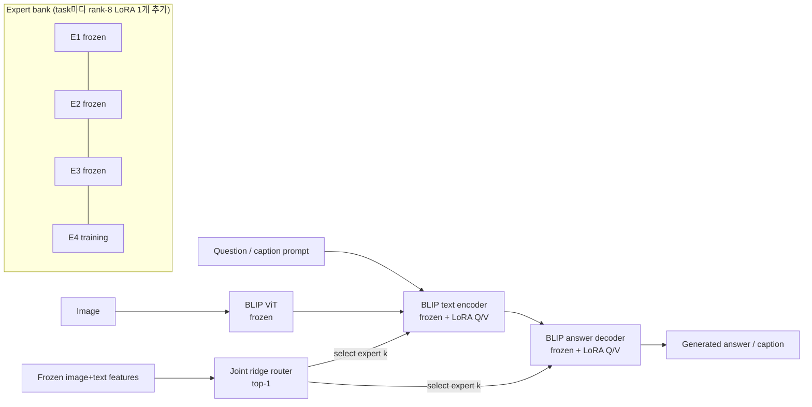

- 새 task마다 rank-8 LoRA expert를 zero-delta(`B=0`)로 추가한다. 이전 expert와 backbone은 동결한다.
- 추론 시 정답 task ID는 주지 않는다. Frozen 특징으로 학습한 ridge router가 expert 하나를 고른다. Router는 task당 128개 특징 벡터를 저장하므로 memory-free 방법은 아니다.
- 이전 expert의 파라미터가 새 expert로 전달되는 경로는 없다. 이전 지식은 router의 expert 선택으로만 재사용된다.

### 3.2 데이터·순서·비교군

| 기호 | Dataset | Family | 지표 | Train / Val / Eval 이미지 |
|---|---|---|---|---|
| V | VQAv2 | VQA | Official consensus accuracy | 2,048 / 256 / 512 |
| C | COCO2014 captions | Caption | CIDEr-D (train-IDF, ×1) | 2,048 / 256 / 512 |
| G | GQA balanced | VQA | Normalized accuracy | 2,048 / 256 / 512 |
| F | Flickr30k (HF mirror, pinned revision) | Caption | CIDEr-D (train-IDF, ×1) | 2,048 / 256 / 512 |

- 총 11,264장. Task·split 간 identity/byte-hash 중복을 검사했다.
- 순서 4개: `V→C→G→F`, `F→G→C→V`, `V→G→C→F`, `F→C→G→V`
- 비교군: Shared LoRA(rank 8), Capacity-matched shared(rank 32), Common replay(과거 task당 64장), Expansion, Frozen-first, Independent, Tuned replay(10 epoch)
- 공통 조건: LR 3e-4, 5 epoch, effective batch 16, greedy decoding, VQA 32 / caption 64 new tokens

### 3.3 평가·통계

- Task 점수를 G1 independent validation 점수(normalizer)로 나눈 뒤 family 안에서 평균한다. 따라서 1을 넘을 수 있다.
- 통계 단위는 seed(8개)다. 각 seed 안에서 4개 order를 먼저 평균한다.
- 주 비교 6개(Expansion vs shared/capacity/replay × 2 family)는 exact two-sided sign-flip 검정과 Holm 보정을 쓴다. 95% CI는 seed bootstrap 20,000회다.
- 8 seed에서 가능한 최소 Holm p는 0.046875다. 유의한 5개 비교가 모두 이 바닥값이므로 p만으로 효과 크기를 비교하면 안 된다.

### 3.4 실행 규모

| 단계 | 내용 | 규모 |
|---|---|---|
| G0 | 데이터·scorer·학습·생성·resume 검증 | GPU smoke |
| G1 | Task별 독립 학습 가능성, normalizer 고정 | 16 runs |
| G2 | VQA↔caption 양방향 pilot | 8 runs |
| G3 | 4-task 개발, replay 설정 선택 | 68 runs |
| **G4** | 새 seed 8개 confirmation | **224 runs**, 예측 1,409,024개 재채점 |
| **G5** | Expert 고정, router 5종 진단 | **160 조건**, 예측 1,081,344개 재채점 |

---

## 4. 확인 실험 결과 (G4/G5)

### 4.1 최종 성능

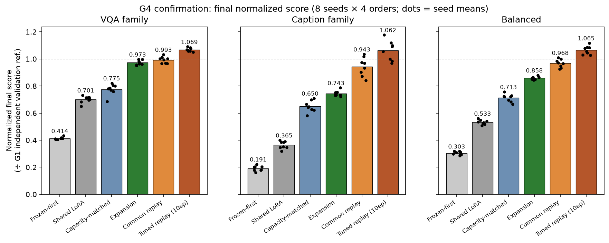

| 방법 | VQA | Caption | Balanced |
|---|---:|---:|---:|
| Frozen-first | 0.414 | 0.191 | 0.303 |
| Shared LoRA | 0.701 | 0.365 | 0.533 |
| Capacity-matched | 0.775 | 0.650 | 0.713 |
| **Expansion** | **0.973** | **0.743** | **0.858** |
| Common replay | 0.993 | 0.943 | 0.968 |
| Tuned replay (10 ep) | 1.069 | 1.062 | 1.066 |

**분석.** Expansion은 같은 용량의 단일 adapter보다 VQA·caption 모두 크게 높다. 단순 용량 증가로 설명되지 않는 보존 효과다. 하지만 replay와의 격차는 VQA에서 작고(−0.020) caption에서 크다(−0.200). Expansion의 약점은 caption family에 집중된다.

### 4.2 사전 등록 비교

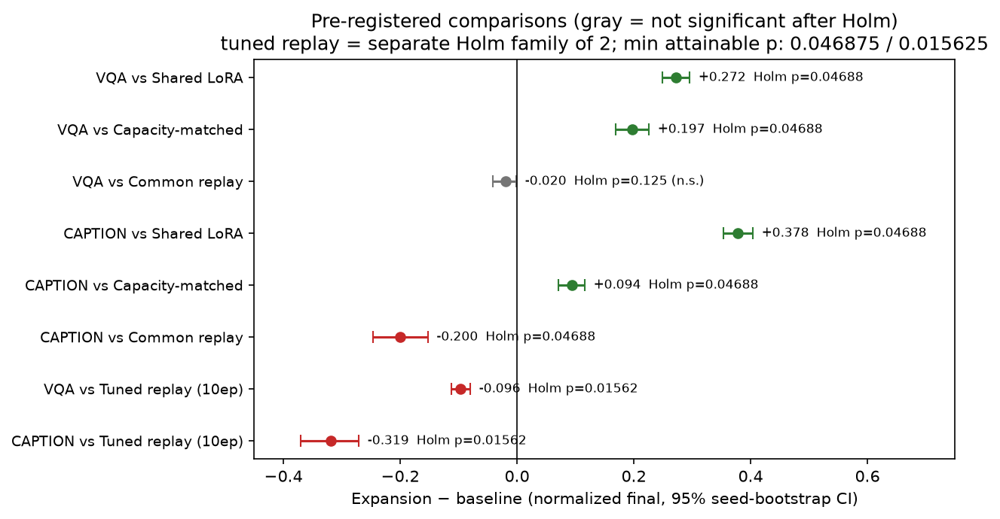

- Shared·capacity 대비 4개 비교는 모두 유의하게 우세하다(Holm p = 0.046875, 가능한 최솟값).
- Common replay 대비 caption은 유의하게 열세다(−0.200). VQA는 bootstrap CI가 0을 넘지 않지만 exact test로는 유의하지 않다(p = 0.125). 비유의가 동등하다는 뜻은 아니다.
- Tuned replay 대비 두 family 모두 유의하게 열세다. 학습 예산이 2배라 별도 비교군으로 둔다.
- **사전 선언한 종합 성공 기준(replay 포함)은 두 family 모두 미충족이다.**

### 4.3 망각과 신규 학습

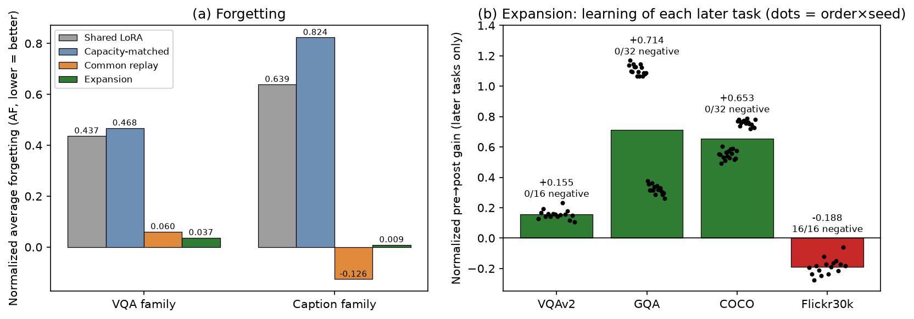

- (a) Expansion의 평균 망각은 VQA 0.037, caption 0.009로 shared(0.437 / 0.639)의 10~70분의 1 수준이다. Replay는 caption에서 음의 AF(이전 task 성능 상승)를 보였다.
- (b) 후속 task 학습 효과는 task마다 다르다. VQAv2·GQA·COCO는 모든 조건에서 개선됐지만 **Flickr30k는 16/16 조건 모두 음의 gain**이다. Family 평균만 보면 이 실패가 가려진다. GQA의 두 군집은 stream 위치에 따라 학습 전 점수가 달라서 생긴다.

### 4.4 전이 분해: routing인가, expert인가

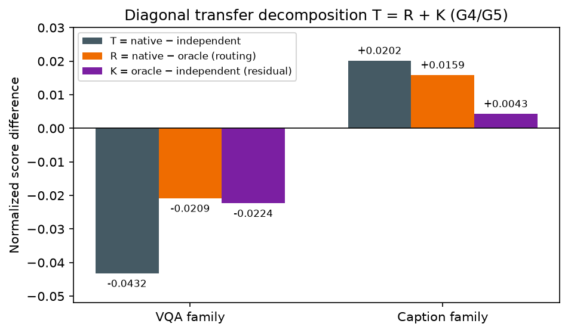

각 task 학습 직후 점수를 `T = native − independent = R + K`로 분해했다.

- `R = native − oracle`: router가 자기 expert를 고르지 못해서 생긴 차이
- `K = oracle − independent`: 자기 expert를 강제해도 남는 차이(초기화·shuffle seed 차이 포함)

VQA의 −0.043 중 약 48%가 routing(R), 나머지가 잔차(K)다. Week 1-B에서 stream 첫 task는 O = I가 bitwise로 성립함을 확인했으므로 K는 2번째 이후 task에서만 생긴다. K가 이전 task로 인한 파라미터 손상이라는 증거는 없다. 이전 expert에서 새 expert로 가는 파라미터 경로가 코드상 없기 때문이다.

### 4.5 Routing 진단 (G5)

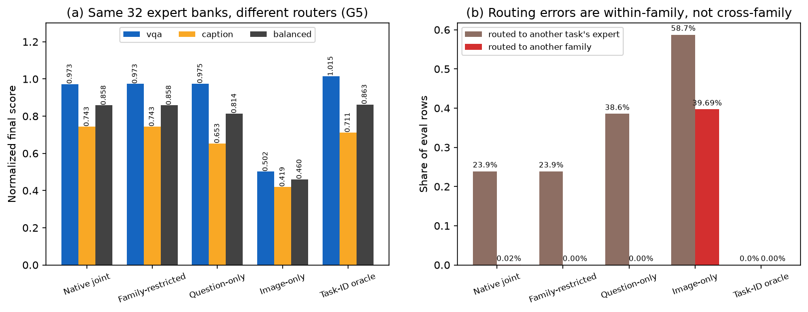

- Native router가 다른 family로 보내는 비율은 0.02%에 불과하다. 오routing(23.9%)은 거의 같은 family 안의 다른 task expert로 간다.
- Family mask를 적용해도 성능 변화가 없다. **Family 구분은 병목이 아니다.**
- Image-only router는 family를 39.7% 틀리고 성능이 절반으로 떨어진다. 질문/지시문 특징이 family 구분을 담당한다.
- Task-ID oracle은 VQA를 개선(0.973 → 1.015)하지만 caption은 오히려 낮다(0.743 → 0.711).

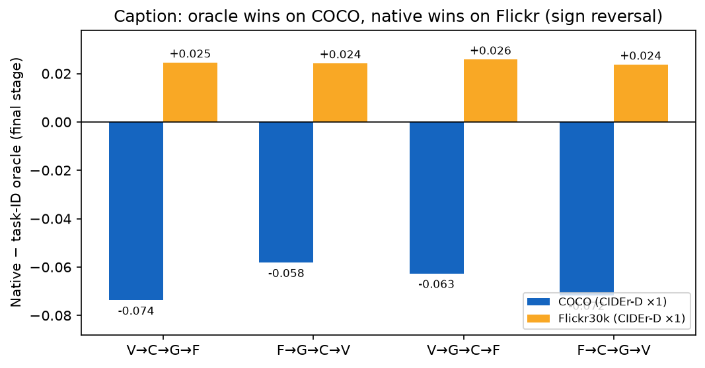

Caption의 native > oracle은 task별로 부호가 반대다. COCO는 자기 expert가 낫고(Δ −0.06~−0.07), Flickr는 COCO expert로 보내는 편이 낫다(Δ +0.024~+0.026). 즉 **Flickr expert 자체가 COCO expert보다 Flickr를 못 한다.** 이 관찰이 "품질 기반 expert 재사용" 아이디어와 Flickr 진단의 출발점이 됐다.

### 4.6 비용

| 방법 | Adapter/expert bytes | Router bytes | Replay 이미지 참조 | 평균 run wall time |
|---|---:|---:|---:|---:|
| Shared | 4.7 MB | 0 | 0 | 1,855 s |
| Capacity-matched | 18.9 MB | 0 | 0 | 1,993 s |
| Common replay | 4.7 MB | 0 | 256장 (약 38.8 MB JPEG 참조) | 1,926 s |
| Expansion | 18.9 MB | 3.2 MB | 0 | 2,141 s |

Expansion bank는 task당 4.7 MB씩 선형으로 늘어난다. GPU-hours, 추론 latency, routing overhead는 기록하지 않았다. 따라서 효율 우위는 주장하지 않는다. 상세는 [연구 정리 §4.7](MULTIMODAL_RESEARCH_SUMMARY.md#47-기존-기록에-근거한-저장시간-비용)에 있다.

---

## 5. 진행 중인 연구: Flickr 실패 원인 진단 (2026-10-16 ~ 10-21)

### 5.1 진단 흐름

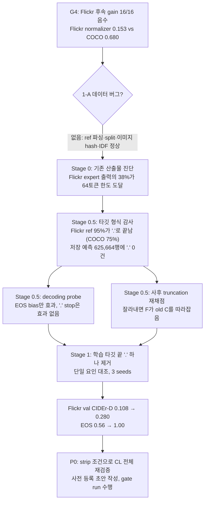

### 5.2 Week 1 검증

| ID | 작업 | 결과 | Artifact |
|---|---|---|---|
| 1-A | Flickr sanity check | **데이터 버그 없음.** Reference 28,143개 파싱, CSV 내부 split, 사용 이미지 2,816장 SHA256, C/F scorer 구성이 모두 정상이다. 예측 50건을 전체 reference와 함께 검수했다. | [week1-flickr-sanity.json](artifacts/week1-flickr-sanity.json), [samples](artifacts/week1-flickr-samples.md) |
| 1-B | Index-0 O = I | **성립.** 첫 task의 oracle과 independent가 32/32 셀에서 예측 문자열·점수·adapter tensor 모두 bitwise 동일하다. Oracle 점수는 stream 위치별로 정확히 묶인다. | [week1-index0-parity.json](artifacts/week1-index0-parity.json) |
| 1-C | Per-example 재채점 | 212,992 occurrence를 재채점했고 저장값과 오차 0이다. 오routing 행의 N−O: VQAv2 −3.0pt, GQA −7.1pt, COCO −0.297, **Flickr +0.144**. Own 행의 차이는 약 0이다. | [report](artifacts/week1-per-example-report.md) |
| 1-D | 문장 불일치 62행 batch-1 재생성 | Oracle 일치 30, native 일치 25, 둘 다 불일치 7. Batch 구성·padding 영향과 양립하지만 원인은 확정하지 않았다. | [week1-batch1-regeneration.json](artifacts/week1-batch1-regeneration.json) |

### 5.3 핵심 발견: 마침표 타깃과 종료 실패

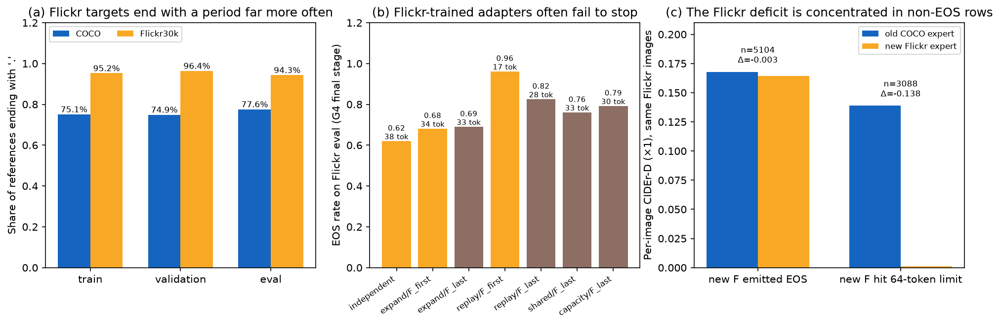

- **(a) 타깃 형식 차이.** Flickr reference의 95.2%가 마침표로 끝난다(COCO 75.1%). BERT tokenizer에서는 `"... street."`가 `... street . [SEP]` 토큰열이 된다. 실제 학습 batch 감사에서도 Flickr 타깃의 95.2%가 `[SEP]` 직전에 마침표 토큰을 가졌다([token audit](artifacts/stage05-target-token-audit.json)).
- **(b) 종료 실패.** Flickr로 학습된 adapter는 G4 eval에서 EOS 도달률이 0.62~0.69이고 평균 33~38토큰을 생성한다. COCO 중심 상태는 EOS 1.00, 약 12토큰이다. Flickr를 늦게 배운 shared/capacity/replay도 EOS가 낮아진다.
- **(c) 손실의 위치.** Flickr-last 16셀에서 새 Flickr expert가 EOS를 낸 행(5,104)은 이전 COCO expert와 거의 같다(Δ −0.003). 64토큰 한도에 도달한 행(3,088)에서는 새 expert 점수가 0.001로 무너지고 COCO expert가 3,029:59로 이긴다.
- 저장된 C/F 예측 625,664행 어디에도 마침표가 없다. Greedy decoding 중 `'.'` 최고 확률의 중앙값은 1e-4다. 학습한 `'. [SEP]'` 종료 패턴이 생성 시 재현되지 않고 `[SEP]` 확률도 낮게 남는다. **이 메커니즘은 가설이다.** 아래 단일 요인 대조로 효과만 확인했다.

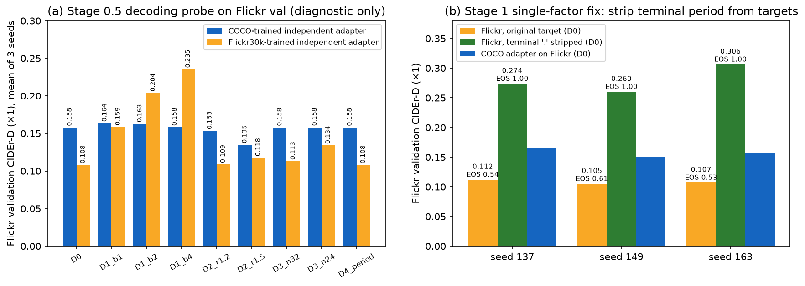

**(a) Stage 0.5 decoding probe** (Flickr validation, independent adapter 3 seeds, 진단 전용):

| 변형 | Flickr adapter CIDEr-D | EOS 도달률 | 해석 |
|---|---:|---:|---|
| D0 greedy | 0.108 | 0.56 | 기준 |
| D1 EOS logit +4 | **0.235** | 1.00 | 종료만 도와도 2배 이상 |
| D2 repetition penalty 1.5 | 0.118 | 0.99 | 반복 억제만으로는 불충분 |
| D3 max 24 tokens | 0.134 | 0.37 | 길이 제한만으로는 불충분 |
| D4 `'.'`에서 정지 | 0.108 | 0.56 | D0과 768/768 동일. `'.'`이 생성되지 않음 |

COCO adapter는 모든 변형에서 약 0.158로 거의 변하지 않는다. 문제는 Flickr로 학습된 adapter의 종료에 국한된다.

**(b) Stage 1 period strip** (학습 타깃 끝의 공백과 마침표 하나만 제거, 나머지 경로 동일):

| Seed | 원 타깃 CIDEr-D (EOS) | **Strip 타깃 CIDEr-D (EOS)** | Paired Δ vs 원 타깃 | Paired Δ vs COCO adapter |
|---|---:|---:|---:|---:|
| 137 | 0.112 (0.54) | **0.274 (1.00)** | +0.162 | +0.108 |
| 149 | 0.105 (0.61) | **0.260 (1.00)** | +0.155 | +0.109 |
| 163 | 0.107 (0.53) | **0.306 (1.00)** | +0.199 | +0.149 |

- 먼저 수정 없는 재학습이 G4 independent F와 bitwise 동일함을 확인했다([fidelity gate](artifacts/stage1-fidelity.json)). 그 위에서 타깃만 바꿨다.
- Strip 후 평균 생성 길이는 약 11.4토큰, 반복 trigram 0%다. Flickr adapter가 이제 COCO adapter보다 Flickr를 잘한다.
- Validation split만 사용했다. Confirmation eval split은 생성·채점에 쓰지 않았다.

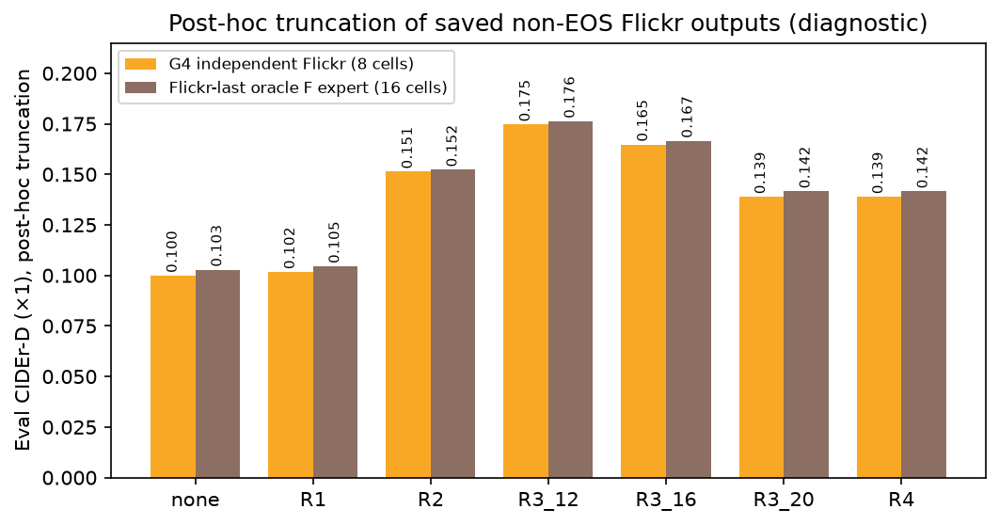

**사후 truncation 재채점**(저장된 eval 예측, 진단 전용)도 같은 방향이다. 비-EOS 출력을 12단어로 자르면 independent F가 0.100 → 0.175, Flickr-last F expert가 0.103 → 0.176이 된다. Old COCO expert 대비 paired Δ는 −0.054에서 +0.019로 부호가 바뀐다. 내용은 학습했지만 멈추지 못한 상태라는 해석과 일치한다([report](artifacts/stage05-truncation-rescore.md)).

### 5.4 이 발견이 기존 결론에 미치는 영향

| 기존 결과 | 영향 |
|---|---|
| Flickr normalizer 0.153 | 종료 실패로 과소추정됐을 가능성이 크다. Caption family 정규화 점수 전체가 영향을 받는다. |
| Flickr 후속 gain 16/16 음수 | 이전 COCO expert가 잘 멈추던 상태에서 멈추지 못하는 Flickr expert로 바뀐 효과가 주원인일 가능성이 있다. |
| Caption native > oracle, Flickr에서 COCO expert 우위 | 오routing된 Flickr 행이 COCO expert의 정상 종료 덕을 본 것일 수 있다. "품질 기반 재사용"의 근거가 약해진다. |
| Expansion vs replay caption 열세 | Replay의 Flickr EOS율이 더 높았다(F_first 0.96). 격차 일부가 종료 artifact일 수 있다. 크기는 재실행 없이 알 수 없다. |
| VQA 결론, shared·capacity 대비 우위 | 직접 영향은 작을 것으로 예상하지만 재검증 범위에 포함한다. |

**[INFERENCE]** 위 영향은 validation 3 seed의 단일 task 대조와 저장 예측의 사후 분석에서 추론한 것이다. CL 전체 stream에서의 효과 크기는 P0 재검증 전까지 확정할 수 없다.

### 5.5 P0 재검증 준비 상태

- **사전 등록 초안** [preregistration-p0-strip.md](preregistration-p0-strip.md) (2026-10-21, draft·미lock): 핵심 claim은 "VQA에서 관찰된 expansion 우위가 VQA + captioning에서도 유지되는가"다. Strip 효과는 exploratory로 둔다. Primary 비교군, 1차 지표, paired 단위, 임계값, 평가 split, L40S 실행 범위가 TBD로 남아 있다.
- **Gate run** (SLURM 2586106, RTX 4090, 2026-10-20, `V→C→G→F` expand seed 137, strip 없음, validation): 재학습 checkpoint의 model 768 tensor와 router 7 tensor가 G4 원본과 **bitwise 동일**하다. 4개 task validation 예측도 G4 checkpoint 재생성과 bitwise 동일하다. 다만 `task_end_03.pt` 스냅샷의 model 일관성 검사가 `false`여서 gate 판정은 **미통과**다. 원인은 아직 조사하지 않았다.
- 결과 노출, 하드웨어 분리(confirmatory는 L40S, 기존 4090 결과는 교차 재현용) 원칙은 초안 §6–7에 있다.

---

## 6. 전체 계획과 진행 상황

### 6.1 로드맵

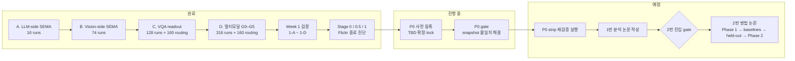

### 6.2 체크리스트

**1번 분석 논문** (확장·동결 CL의 보존 효과와 한계)

| 항목 | 상태 | 비고 |
|---|---|---|
| G0–G5 confirmation, routing 진단 | 완료 | 커밋 `c75c2ba` |
| 연구 정리 리뷰: R/K 분해, 비용 재집계 | 완료 | [MULTIMODAL_RESEARCH_SUMMARY.md](MULTIMODAL_RESEARCH_SUMMARY.md) |
| 1-A Flickr sanity | 완료 | 데이터 버그 없음 |
| 1-B Index-0 O = I | 완료 | 32/32 bitwise |
| 1-C Per-example 재채점 | 완료 | 212,992 rows |
| 1-D Batch-1 재생성 | 완료 | 원인 미확정 |
| Stage 0 Flickr expert 진단 | 완료 | 종료 실패 식별 |
| Stage 0.5 타깃 형식, token audit, decoding probe, truncation | 완료 | 마침표 가설 |
| Stage 1 period strip (validation, 3 seeds) | 완료 | CIDEr-D 0.108 → 0.280 |
| P0 사전 등록 lock | **진행 중** | TBD 7개 항목 |
| P0 gate 통과 | **진행 중** | `task_end_03.pt` snapshot 불일치 조사 필요 |
| P0 strip 조건 CL 재검증 | 대기 | 범위(224 runs 전체 또는 부분) 결정 필요 |
| 1번 논문 초고 (Setup → 결과 → 분해 → routing → 비용 → 한계) | 대기 | P0 결과 반영 후 |

**2번 진입 gate**

| 조건 | 상태 |
|---|---|
| Flickr 데이터 버그 없음 | 충족 (1-A). 단, 데이터가 아닌 **타깃 형식 문제**를 발견했다. |
| 기존 expert가 새 Flickr expert보다 일관되게 나은 샘플군 확인 | **재검토 필요.** COCO expert 우위가 Flickr expert의 비종료 행에 집중되어 있다(3,029:59). 종료가 정상인 행에서는 거의 동률이다. |

계획서의 미충족 분기("재사용 방향을 접고 Flickr expert 학습 문제를 먼저 조사")를 사실상 수행했다. P0 결과로 재사용(A) 방향을 유지할지 결정한다.

**2번 방법 논문** (선택적 재사용·확장, 모두 대기)

| 단계 | 내용 | 예상 규모 |
|---|---|---|
| 2-0 | 사전 계획서. SEMA와의 차별점 문장화, 주 비교 4개로 축소, 10 seeds | 1주 |
| 2-1 | Phase 1 개발: add vs reuse, best-expert 초기화, shared + private, common replay, expansion + replay | 1~2주, 약 12 GPU-h |
| 2-2 | O-LoRA, InfLoRA, SEMA를 생성형 BLIP + Q/V LoRA 구조에 이식 | 3~4주 (병렬) |
| 2-3 | 새 held-out split (기존 eval 제외, hash 재검사) | 2~3일 |
| 2-4 | Phase 2 confirmation: 10 seeds × 4 orders × 약 9 방법 | 2~3주, 약 200 GPU-h |
| 2-5 | 작성 | 2~3주 |

### 6.3 바로 다음 작업

1. P0 gate의 `task_end_03.pt` snapshot model 불일치 원인을 확인한다. 저장 시점 차이인지 비교 로직 문제인지 구분한다.
2. 사전 등록 TBD(primary 비교군, 1차 지표, paired 단위, 임계값, 평가 split, 실행 범위)를 확정하고 lock commit을 기록한다.
3. Strip 조건 CL 재검증을 실행한다. Flickr normalizer 재산정을 포함한다.
4. 결과에 따라 1번 논문의 핵심 주장을 확정한다. 후보는 "확장·동결의 보존 효과 + 생성 task에서 타깃 형식이 만드는 종료 실패가 CL 판정을 왜곡할 수 있다"이다.

---

## 7. 재현

```bash
# 그림 9개 재생성 (읽기 전용: 학습·추론·채점 없음)
uv run --with matplotlib --with numpy python scripts/make_research_figures.py
# NixOS
nix-shell -p 'python3.withPackages(ps: [ps.matplotlib ps.numpy])' --run 'python scripts/make_research_figures.py'
```

| 그림 | 입력 artifact |
|---|---|
| fig1, fig3 | `artifacts/multimodal-g4-report.tar.gz` (`g4/summary.csv`, `g4/tasks.csv`) |
| fig2 | `artifacts/multimodal-g4-statistics.json` |
| fig4, fig6 | `artifacts/routing-review-routing-partition.json` |
| fig5 | `artifacts/multimodal-g5-summary.json` |
| fig7 | `artifacts/stage05-target-format.json`, `artifacts/g4-final-flickr-eos.json`, `artifacts/stage0-flickr-expert-diagnosis.json` |
| fig8 | `artifacts/stage05-decoding-probe.json`, `artifacts/stage1-period-strip.json` |
| fig9 | `artifacts/stage05-truncation-rescore.json` |

실험 실행 명령과 lock, hash, SLURM 기록은 [MULTIMODAL_EXPERIMENTS.md](MULTIMODAL_EXPERIMENTS.md)와 각 artifact의 provenance 필드에 있다. 모델 checkpoint, 원본 이미지, 가상환경은 저장소에 포함하지 않는다.

---

## 8. 참고 문헌

### 8.1 베이스가 된 연구

| 연구 | 이 프로젝트에서의 역할 |
|---|---|
| T. Huai et al. **CL-MoE: Enhancing Multimodal Large Language Model with Dual Momentum Mixture-of-Experts for Continual Visual Question Answering.** CVPR 2025. [arXiv:2503.00413](https://arxiv.org/abs/2503.00413), [code](https://github.com/ECNU-ICALK/CL-MoE) | 프로젝트 출발점. VQAv2 10-task 분할·순서·평가(CL4VQA)를 A–C 단계에서 사용했다. Dual-momentum MoE 자체는 구현·비교하지 않았다. |
| H. Wang, H. Lu, L. Yao, D. Gong. **Self-Expansion of Pre-trained Models with Mixture of Adapters for Continual Learning (SEMA).** CVPR 2025. [arXiv:2403.18886](https://arxiv.org/abs/2403.18886), [code](https://github.com/huiyiwang01/SEMA-CL) | 확장·동결·mixture routing의 원천. A–B 단계에서 이식을 검증했고, 2번 논문에서 차별점을 명시해야 할 핵심 비교 대상이다. |
| Z. Wang et al. **SMoLoRA: Exploring and Defying Dual Catastrophic Forgetting in Continual Visual Instruction Tuning.** ICCV 2025. [arXiv:2411.13949](https://arxiv.org/abs/2411.13949), [code](https://github.com/Minato-Zackie/SMoLoRA) | 멀티모달 CL의 LoRA mixture·routing 선행 연구. 공개 stream 중 VQA task를 A 단계에서 사용했다. 방법 자체와의 성능 비교는 하지 않았다. |
| J. Li, D. Li, C. Xiong, S. Hoi. **BLIP: Bootstrapping Language-Image Pre-training for Unified Vision-Language Understanding and Generation.** ICML 2022. [arXiv:2201.12086](https://arxiv.org/abs/2201.12086) | 고정 backbone |
| E. J. Hu et al. **LoRA: Low-Rank Adaptation of Large Language Models.** ICLR 2022. [arXiv:2106.09685](https://arxiv.org/abs/2106.09685) | Expert 단위(rank-8 Q/V LoRA) |

### 8.2 구조적으로 가까운 연구

| 연구 | 현재 방법과의 차이 |
|---|---|
| R. Aljundi, P. Chakravarty, T. Tuytelaars. **Expert Gate: Lifelong Learning with a Network of Experts.** CVPR 2017. [paper](https://openaccess.thecvf.com/content_cvpr_2017/papers/Aljundi_Expert_Gate_Lifelong_CVPR_2017_paper.pdf) | Task별 전체 네트워크와 autoencoder gate를 쓰고 이전 expert로 새 expert를 초기화한다. 현재 방법은 zero-delta LoRA와 판별적 ridge gate를 쓰며 가중치 이식이 없다. |
| J. Yu et al. **Boosting Continual Learning of Vision-Language Models via Mixture-of-Experts Adapters.** CVPR 2024. [paper](https://openaccess.thecvf.com/content/CVPR2024/html/Yu_Boosting_Continual_Learning_of_Vision-Language_Models_via_Mixture-of-Experts_Adapters_CVPR_2024_paper.html) | CLIP layer 내부 expert pool의 top-2 혼합. 현재 방법은 task별 LoRA bank의 hard top-1 선택이다. |
| A. A. Rusu et al. **Progressive Neural Networks.** [arXiv:1606.04671](https://arxiv.org/abs/1606.04671), 2016 | Lateral connection으로 이전 column 표현을 전달한다. 현재 방법에는 expert 간 연결이 없다. |
| X. Wang et al. **Orthogonal Subspace Learning for Language Model Continual Learning (O-LoRA).** Findings of EMNLP 2023. [paper](https://aclanthology.org/2023.findings-emnlp.715/) | 직교 LoRA 부분공간을 병합해 task ID 없이 추론한다. 2-2 이식 예정 baseline이다. |
| Y.-S. Liang, W.-J. Li. **InfLoRA: Interference-Free Low-Rank Adaptation for Continual Learning.** CVPR 2024. [paper](https://openaccess.thecvf.com/content/CVPR2024/html/Liang_InfLoRA_Interference-Free_Low-Rank_Adaptation_for_Continual_Learning_CVPR_2024_paper.html) | 간섭 없는 부분공간에서 LoRA 일부만 학습한다. 2-2 이식 예정 baseline이다. |
| C. Chen et al. **CoIN: A Benchmark of Continual Instruction Tuning for Multimodel Large Language Models.** NeurIPS 2024 D&B. [arXiv:2403.08350](https://arxiv.org/abs/2403.08350) | 멀티모달 instruction CL benchmark. MoELoRA는 고정 expert 혼합이다. |
| M. Wistuba, P. T. Sivaprasad, L. Balles, G. Zappella. **Continual Learning with Low Rank Adaptation (CoLoR).** [arXiv:2311.17601](https://arxiv.org/abs/2311.17601), 2023 | LoRA 기반 CL 자체가 기존 방향임을 보여준다. |
| A. Chaudhry et al. **On Tiny Episodic Memories in Continual Learning.** [arXiv:1902.10486](https://arxiv.org/abs/1902.10486), 2019 | 작은 replay buffer의 강력함. Replay를 필수 비교군으로 둔 근거다. |

### 8.3 데이터셋과 평가

| 자원 | 서지 |
|---|---|
| VQAv2 | Y. Goyal et al. **Making the V in VQA Matter.** CVPR 2017. [arXiv:1612.00837](https://arxiv.org/abs/1612.00837) |
| GQA | D. A. Hudson, C. D. Manning. **GQA: A New Dataset for Real-World Visual Reasoning and Compositional Question Answering.** CVPR 2019. [arXiv:1902.09506](https://arxiv.org/abs/1902.09506) |
| COCO Captions | X. Chen et al. **Microsoft COCO Captions: Data Collection and Evaluation Server.** [arXiv:1504.00325](https://arxiv.org/abs/1504.00325), 2015 |
| Flickr30k | P. Young, A. Lai, M. Hodosh, J. Hockenmaier. **From image descriptions to visual denotations.** TACL 2014. [paper](https://aclanthology.org/Q14-1006/); 사용 mirror: [nlphuji/flickr30k](https://huggingface.co/datasets/nlphuji/flickr30k) revision `2b239be` |
| CIDEr | R. Vedantam, C. L. Zitnick, D. Parikh. **CIDEr: Consensus-based Image Description Evaluation.** CVPR 2015. [arXiv:1411.5726](https://arxiv.org/abs/1411.5726) |
